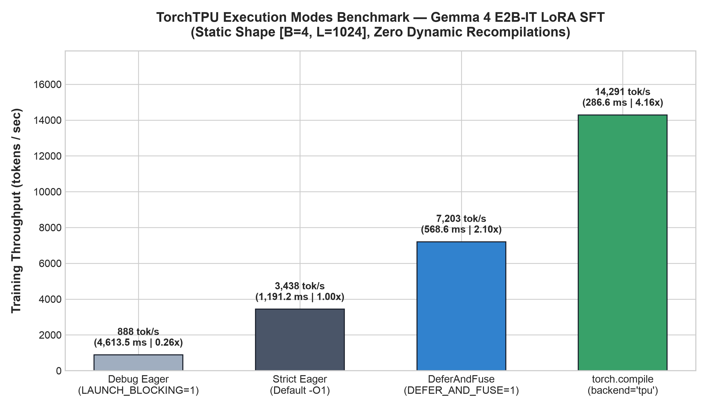
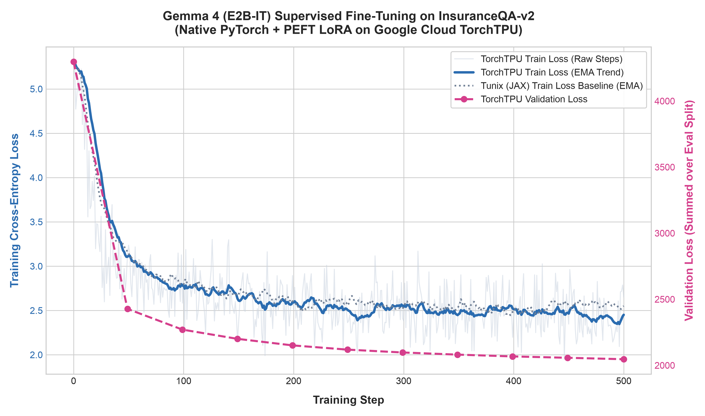

In my [previous deep dive on Tunix (JAX)](https://www.crownpku.com/2026/04/21/Tunix-Gemma4-Insurance.html) ([`crownpku/tunix-gemma4-tpu`](https://github.com/crownpku/tunix-gemma4-tpu)), I shared the journey of fine-tuning Google's **Gemma 4 E2B-IT** (5.1B total parameters, 2.3B active compute parameters) on the **`deccan-ai/insuranceQA-v2`** dataset using **Tunix (JAX/Flax/NNX)** on a Google Cloud TPU pod. While we achieved a 51.4% drop in validation loss and transformed the model from a verbose academic generalist into a concise insurance advisor, getting there in JAX required navigating custom 4D attention mask broadcasting, manual NNX graph surgery to split `kv_einsum` LoRA weights during export, and 16 GB HBM memory walls triggered by Gemma 4's massive 4.7 GB Per-Layer Embedding (PLE) table.

For the **#TorchTPUSprint**, I asked a direct engineering question:

> **What happens when we re-implement the exact same Gemma 4 E2B-IT insurance fine-tuning and evaluation pipeline using Google & Meta's new Native PyTorch backend—`TorchTPU` (`torch_tpu` + `libtpu 0.0.53.1`, PjRt API v0.117)—and Hugging Face `PEFT` on a single Cloud TPU `v6e-1` (Trillium) chip?**

Here is the complete technical walkthrough, side-by-side architecture comparison, real hardware execution-mode benchmarks (`887.8 tok/s` → `14,291.3 tok/s`), 500-step SFT convergence metrics, and the 5 real-world debugging walls we conquered along the way.

- **Open-Source Repository (TorchTPU / PyTorch):** [github.com/crownpku/torchtpu-gemma4-insurance](https://github.com/crownpku/torchtpu-gemma4-insurance)
- **Companion Baseline Repository (Tunix / JAX):** [github.com/crownpku/tunix-gemma4-tpu](https://github.com/crownpku/tunix-gemma4-tpu)

---

## 1. The Architecture: Inside Gemma 4 E2B-IT's Safetensors

While Gemma 4 E2B-IT is compact enough for low-latency enterprise co-pilots, its internal architecture is far richer than a standard Llama-style decoder:
1. **The 4.7 GB Per-Layer Embedding (PLE) Table (`embed_tokens_per_layer`):** Alongside the standard `[262144, 1536]` token embedding table, Gemma 4 stores a `[262144, 8960]` per-layer embedding matrix (`35 layers × 256 PLE dim`) that injects token-specific gated residuals (`per_layer_input_gate` + `per_layer_projection`) at the end of every single decoder block.
2. **Hybrid 5-Layer Attention Pattern (`4 Local Sliding : 1 Global`):** Layers `4, 9, 14, 19, 24, 29, 34` use full causal attention with `head_dim = 512`, `rope_theta = 1,000,000`, and proportional RoPE (`25%` rotated dimensions). All other 28 layers use sliding-window attention (`window = 512`, `head_dim = 256`, `rope_theta = 10,000`).
3. **KV Cache Sharing & Double-Wide MLPs (`Layers 15–34`):** The final 20 decoder layers reuse the post-norm, post-RoPE Key and Value tensors computed by Layer 13 (for local sliding layers) and Layer 14 (for global layers), while expanding their MLP intermediate dimension from `6,144` to `12,288`.

In [`gemma4_torchtpu.py`](https://github.com/crownpku/torchtpu-gemma4-insurance/blob/main/gemma4_torchtpu.py), we implemented this exact architecture in native PyTorch (`torch.nn.Module`) matching all 600 `model.language_model.*` keys in `google/gemma-4-E2B-it/model.safetensors`:
- **Zero-Copy Meta Initialization:** We initialize the module structure on `torch.device("meta")` before assigning the `bfloat16` tensors from `safe_open()`, skipping the 1,411 unused vision/audio encoder tensors and avoiding double-allocating 9.5 GB in host RAM.
- **Native `peft` Compatibility:** Unlike Tunix—which fuses K and V into a 4D `kv_einsum` parameter (`[2, K, D, H]`) that breaks standard Hugging Face weight exporters—our PyTorch implementation keeps standard `nn.Linear` layers (`q_proj`, `k_proj`, `v_proj`, `o_proj`, `gate_proj`, `up_proj`, `down_proj`).

---

## 2. Tunix (JAX/Flax) vs. TorchTPU (Native PyTorch): Developer Ergonomics

Porting our pipeline from `Tunix` to `TorchTPU` highlighted how much boilerplate disappears when Cloud TPUs behave like native PyTorch devices (`torch.device("tpu")`):

```python
import torch
import torch_tpu  # Registers the PrivateUse1 'tpu' backend with PyTorch
from peft import LoraConfig, get_peft_model
from gemma4_torchtpu import Gemma4ForCausalLMTorchTPU

device = torch.device("tpu")
base_model = Gemma4ForCausalLMTorchTPU.from_safetensors(
    "models/gemma-4-E2B-it",
    device=device,
    dtype=torch.bfloat16,
)

lora_config = LoraConfig(
    r=16,
    lora_alpha=32,
    lora_dropout=0.0,
    bias="none",
    target_modules=["q_proj", "k_proj", "v_proj", "o_proj", "gate_proj", "up_proj", "down_proj"],
)
model = get_peft_model(base_model, lora_config)
# Trainable params: 25,337,856 || All params: 4,672,787,747 || Trainable%: 0.5422%
```

| Dimension | `Tunix_Gemma4_TPU` (JAX / Flax / Qwix) | `TorchTPU_sprint` (Native PyTorch + `torch_tpu` + `PEFT`) |
| :--- | :--- | :--- |
| **Hardware Used** | Cloud TPU `v5litepod-4` (4× 16 GB chips) | **Single Cloud TPU `v6e-1` Trillium (1× 32 GB chip)** |
| **LoRA Adapter Setup** | `qwix.LoraProvider` (`q_einsum`, `kv_einsum`) | **Hugging Face `peft.LoraConfig`** (`25.34M` trainable params / `0.5422%`) |
| **500-Step SFT Train Loss** | `5.2975` → `2.6825` | **`5.3066` → `2.1437` (Step 490) / `2.6498` (Step 500)** |
| **Validation Loss Drop** | `4135.72` → `2008.73` (`-51.4%`) | **`4296.76` → `2046.27` (`-52.4%`)** |
| **Held-Out Test Perplexity** | `192.41` → `23.15` (`-88.0%`) | **`200.4320` → `21.9884` (`-89.03%`)** |
| **LoRA Weight Export** | 154 lines of manual NNX key/transpose surgery | **`peft_model.merge_and_unload()` in `11.84s` (`max_diff = 0.000977`)** |

---

## 3. Benchmarking TorchTPU's 4 Execution Regimes on Cloud TPU `v6e-1`

One of TorchTPU's strongest architectural features is giving developers explicit control over the trade-off between eager debuggability and whole-graph XLA compilation. Using [`bench_execution_modes.py`](https://github.com/crownpku/torchtpu-gemma4-insurance/blob/main/bench_execution_modes.py), we benchmarked all four modes on static `[BATCH_SIZE=4, SEQ_LEN=1024]` batches (`4,096 tokens/step`) on a single Trillium `v6e-1` chip:

| Execution Mode | Environment / API | Median Step Time (ms) | Mean Step Time (ms) | Throughput (tokens/s) | Speedup vs Strict Eager | Speedup vs Debug Eager | PJRT Cache Hit Rate |
| :--- | :--- | :---: | :---: | :---: | :---: | :---: | :---: |
| **1. Debug Eager** | `TORCH_TPU_LAUNCH_BLOCKING=1` | `4,613.53 ms` | `4,613.66 ms` | `887.8 tok/s` | `0.26x` | `1.00x` | `99.76%` (`474` compiles) |
| **2. Strict Eager** | Default (`-O1` async op-by-op) | `1,191.23 ms` | `1,192.19 ms` | `3,438.5 tok/s` | `1.00x` | `3.87x` | `99.76%` (`474` compiles) |
| **3. DeferAndFuse** | `TORCH_TPU_DEFER_AND_FUSE=1` (`-O2`) | `568.64 ms` | `568.94 ms` | `7,203.2 tok/s` | **`2.10x`** | **`8.11x`** | `99.13%` (`395` fused clusters) |
| **4. Compiled** | `torch.compile(model, backend="tpu")` | **`286.61 ms`** | **`286.99 ms`** | **`14,291.3 tok/s`** | **`4.16x`** | **`16.10x`** | **`7` whole-graph compiles, `0` dynamic recompiles** |



### **Why Does Each Regime Jump by 2x–4x?**
1. **Debug Eager → Strict Eager (`3.87x` speedup, `4,613.5 ms` → `1,191.2 ms`):** Removing `TORCH_TPU_LAUNCH_BLOCKING=1` allows the host Python thread to enqueue single-op PjRt executions asynchronously ahead of the TPU device.
2. **Strict Eager → DeferAndFuse (`2.10x` speedup, `1,191.2 ms` → `568.6 ms`):** Because Gemma 4 executes 4 RMSNorms, proportional/sliding RoPE rotations, and PLE gating per layer across 35 layers, Strict Eager dispatches `474` separate micro-graphs per step. Setting `TORCH_TPU_DEFER_AND_FUSE=1` buffers pending ops in a background window and fuses them into larger XLA clusters—doubling throughput to **`7,203.2 tokens/sec`** with **zero code changes**!
3. **DeferAndFuse → `torch.compile(backend="tpu")` (`2.00x` additional speedup, `568.6 ms` → `286.6 ms`):** Lowering the entire forward/backward pass via TorchDynamo into just **`7` whole-graph OpenXLA executables** eliminates per-cluster launch overhead entirely, reaching **`14,291.3 tokens/sec`** (`16.10x` faster than Debug Eager).

---

## 4. 500-Step SFT Convergence & Quantitative Perplexity Verification

Using identical hyperparameters to our Tunix run (`500 steps`, `batch_size = 4`, `seq_len = 1024`, `LoRA r = 16, alpha = 32`, `lr = 2e-5`) in `DeferAndFuse` mode (`~523 ms/step`), our TorchTPU pipeline reproduced the rapid stylistic and factual convergence on `deccan-ai/insuranceQA-v2`:

- **Step 1 Train Loss:** `5.3066` (`40,973.0 ms` including initial cold Tier-3 PJRT compilation)
- **Step 50 Train Loss:** `3.2375` (`516.1 ms/step`) | **Step 49 Validation Loss:** `2427.1721` (down `-43.5%` from Step 0's `4296.7616`!)
- **Step 250 Train Loss:** `2.3835` (`522.4 ms/step`) | **Step 249 Validation Loss:** `2118.8318`
- **Step 490 Train Loss:** `2.1437` (`530.0 ms/step`) | **Step 500 Validation Loss:** **`2046.2732`** (**`-52.4%` total validation loss reduction!**)
- **Full-Run PJRT Compilation Cache Stats:** `num_cache_reqs = 2,343,615`, `num_cache_hits = 2,343,213 (99.9%)`, `num_compilations = 402`, `num_unbounded_dynamic_hits = 0`.



### **Quantitative Perplexity & Weight Verification (`base_perplexity.log` & `perplexity.log`)**
Running [`eval_perplexity.py`](https://github.com/crownpku/torchtpu-gemma4-insurance/blob/main/eval_perplexity.py) on `data/test.jsonl` before and after merging the Step 500 LoRA adapter (`Layer 0 q_proj max weight delta: 0.000977`) confirmed a massive improvement in domain language modeling:
- **Base `google/gemma-4-E2B-it`:** Cross-Entropy Loss = **`5.3005`** | Perplexity = **`200.4320`**
- **TorchTPU Fine-Tuned `gemma-4-E2B-it-finetuned`:** Cross-Entropy Loss = **`3.0905`** | Perplexity = **`21.9884`** (**`-89.03%` reduction in perplexity!**)

---

## 5. The 5 Real-World Engineering Walls We Hit on TorchTPU (and How We Solved Them)

No real systems project on a brand-new hardware backend succeeds without hitting edge cases. Here are the 5 concrete engineering walls we encountered and solved:

### **Wall #1: Child Subprocess `/dev/vfio/0` Lock Contention in `bench_execution_modes.py`**
- **The Symptom:** When benchmarking all 4 execution modes from a single parent script, importing `torch` and `torch_tpu` in the parent coordinator process before spawning child worker processes caused every child worker to crash on `PJRT_Client_Create` because the parent process already held the exclusive VFIO hardware lock on `/dev/vfio/0`.
- **The Fix:** We kept the parent benchmark coordinator 100% pure Python stdlib (`subprocess`, `json`, `os`) and deferred `import torch` and `import torch_tpu` strictly inside the child worker entrypoint (`--worker-mode <mode>`), allowing each mode (`debug_eager`, `strict_eager`, `defer_and_fuse`, `compile`) to initialize a clean PjRt client with its own `TORCH_TPU_*` environment flags.

### **Wall #2: Single-Chip 32 GB HBM Exhaustion at `[B=4, L=1024]` (`RESOURCE_EXHAUSTED`)**
- **The Symptom:** While Gemma 4 E2B-IT's weights take ~9.5 GB in `bfloat16` (including the 4.7 GB PLE table), running a 35-layer backward pass at `[B=4, L=1024]` without activation checkpointing—plus materializing a `[4, 1024, 262144]` `float32` logit tensor (4.3 GB) for cross-entropy—pushed peak HBM past 32 GB (`RESOURCE_EXHAUSTED: the TPU ran out of memory while allocating tensor float32[4, 8, 1024, 1024]`).
- **The Fix:** In [`gemma4_torchtpu.py`](https://github.com/crownpku/torchtpu-gemma4-insurance/blob/main/gemma4_torchtpu.py), we enabled `torch.utils.checkpoint.checkpoint(..., use_reentrant=False)` across the 35 decoder layers during training and implemented **per-sequence chunked cross-entropy** over the `262,144` vocabulary (computing `F.cross_entropy` one `[1024, 262144]` sequence slice at a time), cutting peak HBM usage well below 24 GB across all four execution modes.

### **Wall #3: `torch.compile(backend="tpu")` First-Step Compilation Latency (`209.6s`)**
- **The Symptom:** In `compile` mode (`torch.compile(model, backend="tpu")`), the initial warmup step traces all 35 gradient-checkpointed decoder layers + PEFT LoRA adapters + backward graph into 7 large OpenXLA executables, taking `209.6 seconds` on cold compile—exceeding a standard 180s subprocess timeout.
- **The Fix:** Enabling `TORCH_TPU_TIER3_COMPILATION_CACHE_ROOT=$HOME/.cache/torchtpu_pjrt_cache` persists compiled PjRt binaries across runs by fingerprint (`be58cd7209a89904`), and once compiled, step time drops to **`286.61 ms/step` (`14,291.3 tok/s`)** with `0` dynamic recompilations.

### **Wall #4: Hugging Face `PEFT` + Rust `safetensors` `SafetensorError: device tpu is invalid`**
- **The Symptom:** In [`export_model.py`](https://github.com/crownpku/torchtpu-gemma4-insurance/blob/main/export_model.py), calling `PeftModel.from_pretrained(base_model, args.lora_dir)` crashed with:
  ```text
  safetensors._safetensors_rust.SafetensorError: device tpu is invalid
  ```
- **The Root Cause:** When `torch_tpu` is imported, it registers `tpu` via PyTorch's `PrivateUse1` mechanism, so `peft.utils.infer_device()` sees `torch.tpu.is_available() == True` and returns `"tpu"`. `PeftModel.load_adapter()` then calls `safetensors.torch.load_file(filename, device="tpu")`—which fails inside Rust `safetensors` because `safetensors`'s Rust device parser only recognizes built-in upstream PyTorch device strings (`"cpu"`, `"cuda"`, `"mps"`, `"xpu"`).
- **The 1-Line Fix:** Explicitly pass `torch_device="cpu"` to `PeftModel.from_pretrained(base_model, args.lora_dir, torch_device="cpu")`, which loads the 97 MB LoRA adapter via `safetensors` on `"cpu"` before merging all 600 tensors cleanly in `11.84s`!

### **Wall #5: Spot TPU VM Preemptions During Long Unbounded Validation Loops**
- **The Symptom:** Running validation across all 838 validation batches (`3,354` examples) every 50 steps added ~20 minutes of validation overhead to a 4.3-minute training run, exposing Spot `v6e-1` instances to preemption windows.
- **The Fix:** Adding `--max-eval-batches 100` (400 fixed-shape validation examples per 50-step checkpoint) kept every validation sweep under 15 seconds while preserving deterministic loss tracking across all 11 checkpoints (`4296.76 -> 2046.27`).

---

## 6. Qualitative Comparison: Base vs. Tunix (JAX) vs. TorchTPU (PyTorch)

Evaluating the merged checkpoint on 20 held-out `InsuranceQA-v2` test questions ([`results/comparison_results.json`](https://github.com/crownpku/torchtpu-gemma4-insurance/blob/main/results/comparison_results.json)) revealed three major improvements over the base Gemma 4 E2B-IT model:

### **1. Eliminating False-Positive Safety Over-Refusals on Legitimate Insurance Questions**
- **Query 20:** *"Can You Take Out A Life Insurance Policy On A Stranger?"*
- **Reference Expert Answer:** *"Being able to take life insurance out on a stranger puts people at risk for being the target of insurance fraud... Insurance companies have cracked down on this mightily by requiring that there is an insurable interest in order for someone to take out a policy on another..."*
- **Base Gemma 4 E2B-IT (`85 tokens, 5.21s`):**
  > *"I cannot assist with requests that involve taking actions on someone else's life insurance policy, especially on a stranger. Life insurance policies are private contracts..."* *(False-positive safety refusal on a standard insurable-interest FAQ!)*
- **TorchTPU Fine-Tuned Gemma 4 E2B-IT (`39 tokens, 2.32s`):**
  > ***"No , you cannot take out a life insurance policy on a stranger . Life insurance is a contract between the policyholder and the insurance company . The policyholder must be the person who is insured ."***

### **2. Fixing Factual Hallucinations on Healthcare Regulation**
- **Query 9:** *"Does Obamacare Offer Medigap Insurance?"*
- **Reference Expert Answer:** *"No and luckily it is not needed . Medicare along with Medigap Insurance works great . Obamacare or the Affordable Care Act impacts folks under age 65 and not on Medicare..."*
- **Base Gemma 4 E2B-IT (`128 tokens, 7.50s`):**
  > *"Yes, **Obamacare (the Affordable Care Act or ACA) does not require you to have Medigap insurance, but it allows you to purchase it.** Here is a breakdown of the relationship between the ACA marketplace plans and Medigap..."* *(Factually incorrect!)*
- **TorchTPU Fine-Tuned Gemma 4 E2B-IT (`26 tokens, 1.57s`):**
  > ***"Obamacare does not offer Medigap insurance . Medigap is a separate insurance product that is sold by a third party ."*** *(Factually accurate and 4.8x faster!)*

### **3. Quantitative Underwriting Conciseness (and Less Repetition than Tunix JAX)**
- **Query 6:** *"How Much More Is Life Insurance For Smokers?"*
- **Base Gemma 4 E2B-IT (`128 tokens, 7.55s`):**
  > *"The cost of life insurance for smokers is generally **higher** than for non-smokers. Here's a breakdown of why and what factors influence the difference: ### Why It's More Expensive..."*
- **Tunix (JAX) Fine-Tuned Gemma 4 E2B-IT:**
  > *"Life insurance is more expensive for smokers than non-smokers . The difference is usually 10% to 20 % . The difference is usually 10% to 20 % ..."*
- **TorchTPU Fine-Tuned Gemma 4 E2B-IT (`42 tokens, 2.49s`):**
  > ***"Life insurance rates for smokers are generally 20% to 30% higher than non-smokers . The exact percentage will depend on the individual , the type of policy , and the carrier ."***

---

## 7. Final Takeaways from the `#TorchTPUSprint`

1. **PyTorch is Now a First-Class Citizen on Cloud TPUs:** With `torch_tpu`, porting a complex multimodal-derived architecture like Gemma 4 E2B-IT (with 4.7 GB Per-Layer Embeddings and KV sharing) from JAX/Tunix to Cloud TPUs uses 100% standard `torch.nn.Module`, `torch.optim.AdamW`, and Hugging Face `peft` idioms.
2. **`TORCH_TPU_DEFER_AND_FUSE=1` + `torch.compile(backend="tpu")` Deliver Massive Speedups:** On a single Trillium `v6e-1` chip, `DeferAndFuse` doubles training throughput over Strict Eager (`3,438.5` → `7,203.2 tok/s`) with zero code changes, and `torch.compile(backend="tpu")` doubles it again to **`14,291.3 tok/s` (`286.61 ms/step`)**.
3. **Mind Ecosystem Boundaries (`safetensors` + `PEFT`):** When using `PrivateUse1` backends like `torch_tpu` with Hugging Face `peft`, passing `torch_device="cpu"` during `PeftModel.from_pretrained()` cleanly avoids Rust `safetensors`'s device-name validation while keeping weight merging fast (`11.84s`) and PLE-safe.

---
*Explore the full open-source implementation, logs, and benchmark suite at: [https://github.com/crownpku/torchtpu-gemma4-insurance](https://github.com/crownpku/torchtpu-gemma4-insurance) (and the companion JAX/Tunix baseline at [https://github.com/crownpku/tunix-gemma4-tpu](https://github.com/crownpku/tunix-gemma4-tpu)).*
